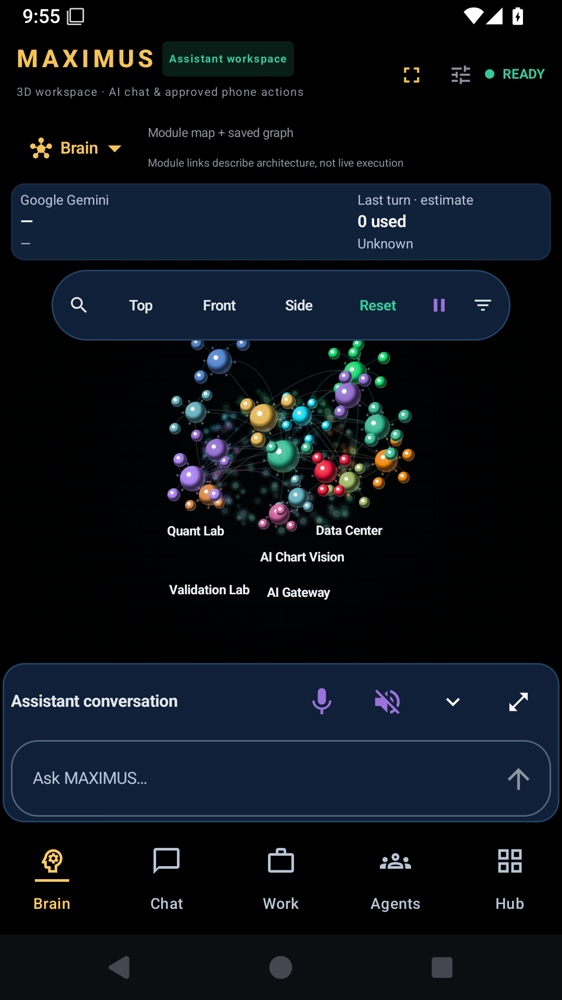
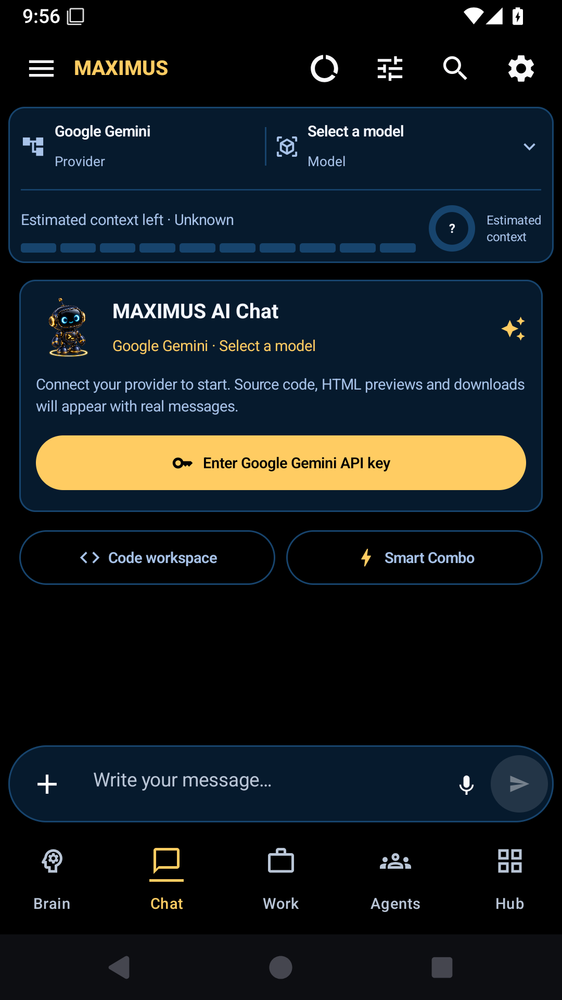
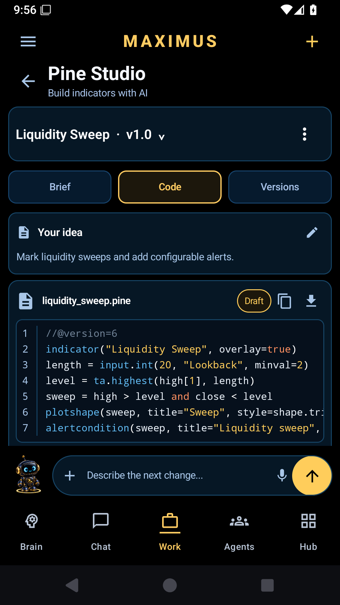
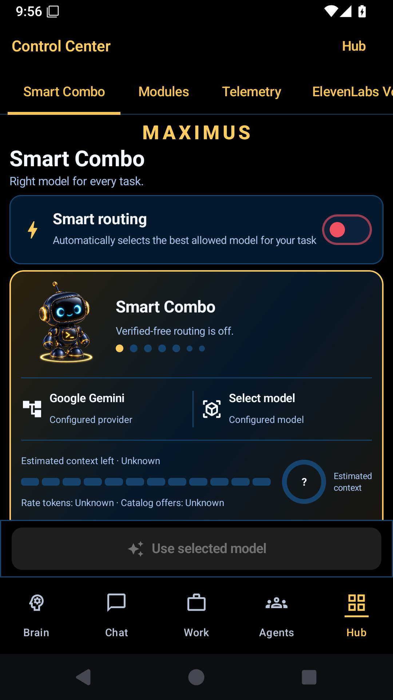

  

<h1 align="center">MAXIMUS MATRIX OS</h1>

<strong>Think. Build. Stay ahead.</strong> One Android workspace for your assistant, projects and market intelligence.

  <a href="https://github.com/drfxai/Maximus-Matrix-OS/releases/tag/v1.0.0"><strong>Download V1.0.0</strong></a>
  · Android 8.0+
  · Build 10033

### One connected workspace

- **Brain & Chat** — explore the interactive graph and talk with models you connect.
- **Work & Pine Studio** — organize projects, edit Pine drafts and export source.
- **Smart Combo** — choose among eligible models with visible capability and usage evidence.
- **News Intelligence** — follow publisher news and an optional daily or weekly economic calendar with event reminders.

  

### Inside the app

| Brain | Chat | Pine Studio | Smart Combo |
|:---:|:---:|:---:|:---:|
|  |  |  |  |

Screenshots are from the released build's Android emulator with no connected account. The wide banners are illustrations.

### Get started

Download the [ARM64 or universal APK](https://github.com/drfxai/Maximus-Matrix-OS/releases/tag/v1.0.0), install or update the app, then connect your own model provider and optional news calendar feed. The app keeps unverified account limits visibly unknown. Pine Studio previews are illustrative; full Pine compilation and backtesting are not included.

Built with Kotlin, Jetpack Compose and Android SDK 36. See the [changelog](CHANGELOG.md) and [news feed setup](docs/news-feed-v1.md).
